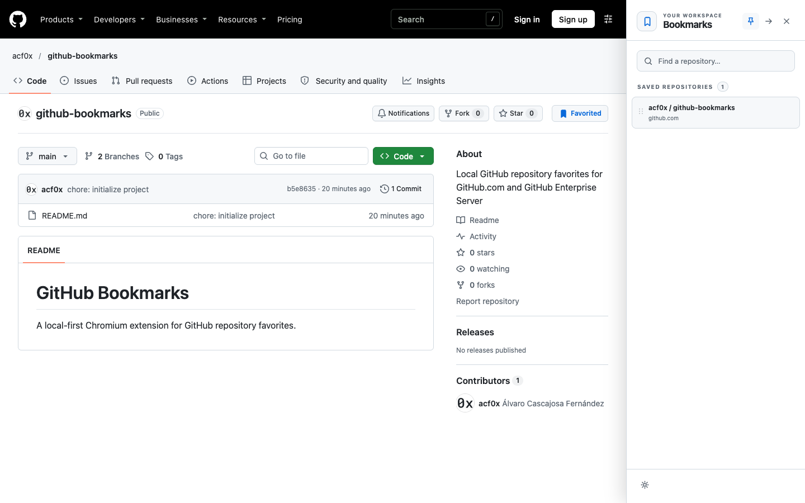

# GitHub Bookmarks

A small Chromium and Firefox extension for saving GitHub repositories in an integrated sidebar. Bookmarks are local to this browser profile. It works on `github.com` and on GitHub Enterprise Server (GHES) domains that you explicitly approve. No token, OAuth flow, GitHub API, or backend is involved.



## Install

For Chrome 123+ or Edge 123+, download and extract the [Chromium release ZIP](https://github.com/acf0x/github-bookmarks/releases/tag/v0.1.1), or clone `main`. This quick path uses mdxcn's [Steps Markdown representation](https://mdxcn.dev/docs/steps):

```text
+------------------ [ INSTALL ] -------------------+
|                                                  |
| 1  Get the files                                 |
|    Extract the ZIP, or clone the repository.     |
| │                                                |
| 2  Enable Developer mode                         |
|    Open chrome://extensions.                     |
|    In Edge, open edge://extensions.              |
| │                                                |
| 3  Load unpacked                                 |
|    Choose the ZIP root or the repository's dist. |
| │                                                |
| 4  Open a GitHub repository                      |
|    Use the favorite button or sidebar handle.    |
|                                                  |
+--------------------------------------------------+
```

The committed `dist` folder is ready to load. To rebuild it from source, install Node.js 22+ and run:

```sh
npm ci
npm run build
```

After rebuilding, click **Reload** for the extension on the browser extensions page.

For Firefox 142+, the release includes an **unsigned XPI for temporary use**. Open `about:debugging`, select **This Firefox** → **Load Temporary Add-on**, and choose the XPI. Firefox removes temporary add-ons when it closes; permanent installation in Firefox stable requires Mozilla signing. The Firefox build is in `dist-firefox` and uses a background script instead of a service worker.

## Use

- Click **Add favorite** in a repository header, or open the sidebar and choose **Add current repository**. Click the header button again or use the row's remove control to unsave it.
- The sidebar is available on GitHub repository, organization, and dashboard pages. Open it with the edge handle; close it with the X button or pin it to reserve space beside GitHub content.
- Use the header controls to move the sidebar between left and right. Drag its inner edge to resize it. These preferences persist locally.
- Drag the edge handle up or down to reposition it. Drag it across the middle of the screen to dock the sidebar on the other side.
- Use the pencil on a saved row to give it a custom name; an empty name restores the default.
- Use the plus in the **Saved repositories** header to create folders. Assign a repository with the row's folder selector or by dragging it onto a folder, and expand or collapse folders with their arrow.
- The sun/moon button in the footer switches between light and dark; the sliders button opens Enterprise host settings.
- Search by owner, repository name, or hostname. Drag rows to reorder them, or use each row's **Move up** and **Move down** buttons with the keyboard. Links keep normal browser behavior, including open in a new tab.
- The extension toolbar icon opens Enterprise host settings.

### Add GitHub Enterprise Server

1. Click the extension icon and enter the GHES hostname, such as `github.company.example`. An `https://` prefix is optional. Paths, ports, HTTP, and wildcards are rejected.
2. Click **Add host**. The browser asks for access to that specific HTTPS host. Approve it to enable integration.
3. Reload any tabs already open on that host. New pages then get the sidebar and repository button.
4. Remove a host on the same page to unregister its script and revoke that exact origin permission. Reload any already open pages to remove their existing injected UI.

This does not sign in to GHES. Sign in through your browser as usual. The extension never reads cookies or credentials.

## Privacy and permissions

| Permission             | Why it is used                                                                                                                        |
| ---------------------- | ------------------------------------------------------------------------------------------------------------------------------------- |
| `storage`              | Save bookmarks, approved hosts, and sidebar preferences in `chrome.storage.local`.                                                    |
| `scripting`            | Register and unregister a content script for each approved GHES host.                                                                 |
| `https://github.com/*` | Run the sidebar and repository button on GitHub.com.                                                                                  |
| Optional `https://*/*` | Allows the browser to offer an exact HTTPS origin grant for a user-entered GHES host. The extension never requests all hosts at once. |

The extension does not use `tabs`, `cookies`, `identity`, `webRequest`, analytics, external assets, or remote code. It makes no GitHub API calls and sends no bookmarks to other services. It does not synchronize across devices; only tabs in the same browser profile share local state. Browser backup policies may still govern the profile itself.

## Development and verification

```sh
npm ci
npm run check
npx playwright install chromium
npm run test:browser
npx -y web-ext lint --source-dir dist-firefox
```

`npm run check` runs TypeScript, ESLint, Prettier, unit tests, both production builds, and manifest validation. `npm run test:browser` loads the unpacked extension in an isolated Chrome for Testing profile and covers button injection, sidebar interactions, SPA navigation, header replacement, persistence, cross-tab updates, light/dark themes, and a mocked GHES domain. Its GHES fixture uses an exact temporary test permission; the native browser permission prompt still requires a human click in the production flow. Tests never need corporate credentials.

Screenshots: [light theme](screenshots/light.png), [dark theme](screenshots/dark.png), [public GitHub page](screenshots/github-live.png).

## Scope and limits

Repository identity is the HTTPS origin plus owner and repository name. The extension only offers bookmarking when the current page has recognizable repository metadata. An unusual GHES theme that removes those markers can still show the sidebar but may not expose **Add current repository**. Real corporate GHES layouts and SSO were not tested; the Enterprise checks use fixtures. Existing GHES tabs need a reload after granting or removing a host. Disabling the extension may also require a page reload to remove UI already injected into an open tab.

This is a repository bookmark tool. It does not explore code, manage issues or pull requests, mirror GitHub Stars, discover repositories, or use GitHub authentication APIs.

## Documentation

- [Architecture and storage model](docs/architecture.md)
- [GitHub Enterprise setup](docs/GITHUB_ENTERPRISE.md)
- [Security and permissions](docs/SECURITY.md)
- [Development](docs/DEVELOPMENT.md), [testing](docs/TESTING.md), and [releasing](docs/RELEASING.md)
- [Attribution](ATTRIBUTION.md) and [changelog](CHANGELOG.md)
